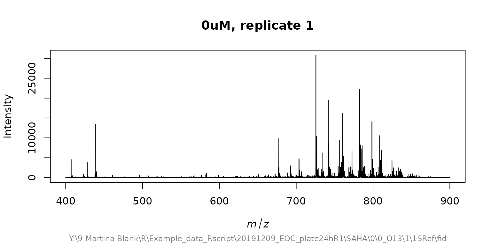
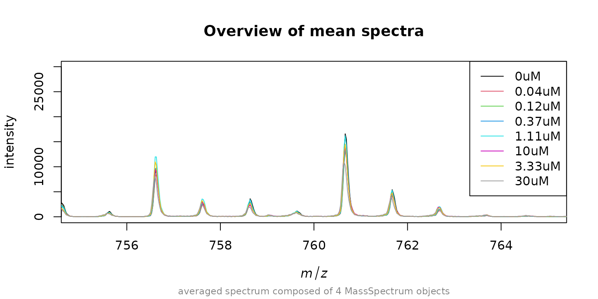
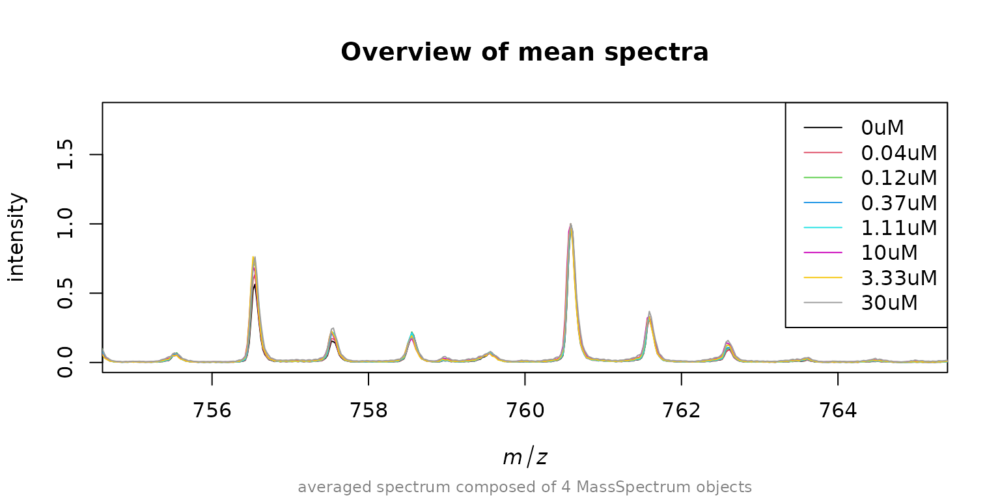
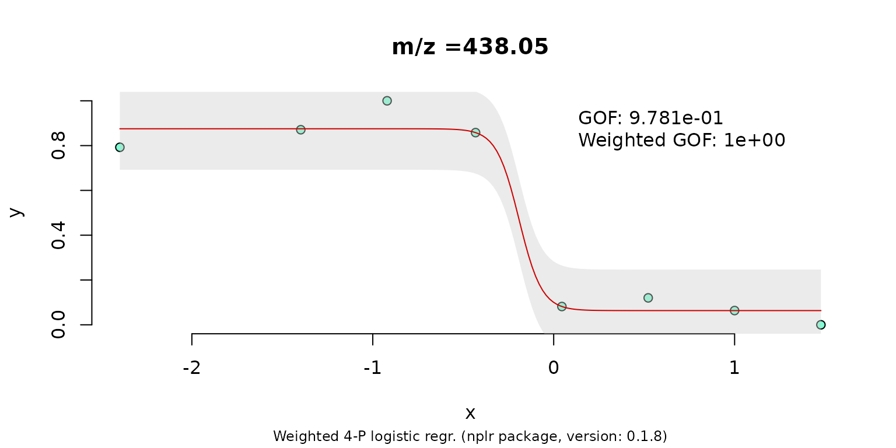
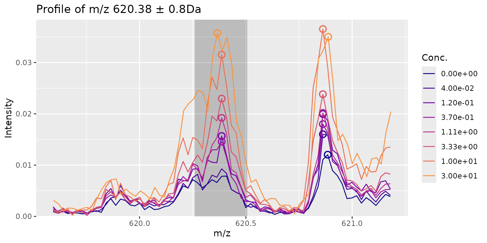
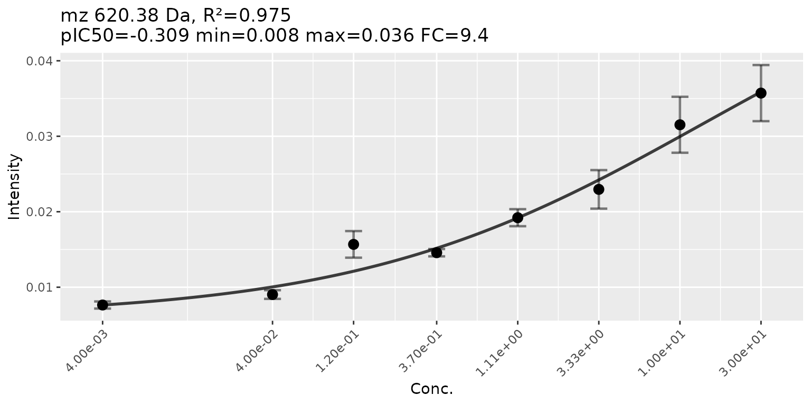
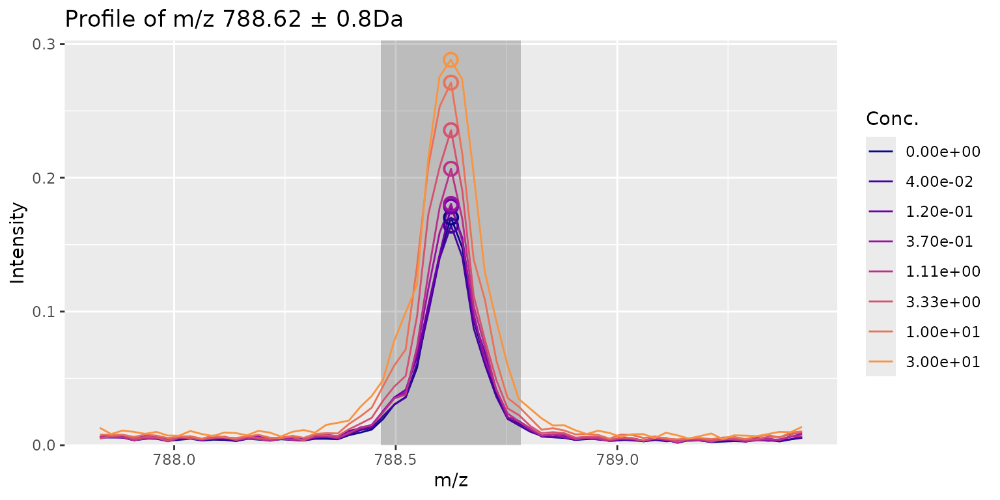
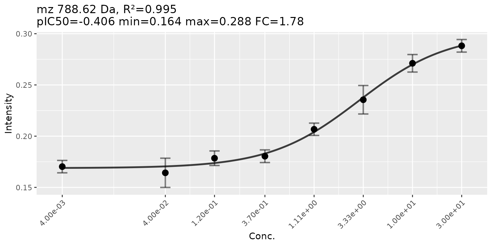

# MALDI cell based assay Example

### Introduction

In this document we will apply an automated screening for possible
candidate signals that show a response to treatment with a compound. For
details how to do the experimental part check out our Nature Protocols
publication [Unger 2021 “Label-free Cell Assays of Compound Uptake and
Drug Action using MALDI-TOF Mass
Spectrometry”](https://doi.org/10.1038/s41596-021-00624-z). Briefly,
cells were treated with the following concentration of a compound: 0,
0.04, 0.12, 0.37, 1.11, 3.33, 10, 30 uM. After incubation the cells were
washed, transferred to a MALDI target plate and matrix was applied. For
each concentration 4 spots were applied which means that we also have 4
“measurement replicates” for each concentration.

The most important function in this package is
[`fitCurve()`](https://cemos-mannheim.github.io/MALDIcellassay/reference/fitCurve.md).
It does not only fit the dose response curve and compute score values
but it also does most of the necessary steps needed to prepare the data
for fitting like normalization and alignment. In this tutorial we want
to first look at each of this steps individually and then apply the
[`fitCurve()`](https://cemos-mannheim.github.io/MALDIcellassay/reference/fitCurve.md)
function the helps us combine all of them.

For the sake to keep this package small, the spectra used as an example
here were trimmed to 400-900 Da mass-range and stored in a compact form
as example data.

### Example data and quality check

``` r

library(MALDIcellassay)
library(MALDIquant)
#> 
#> This is MALDIquant version 1.22.3
#> Quantitative Analysis of Mass Spectrometry Data
#>  See '?MALDIquant' for more information about this package.
```

``` r

data("Blank2022spec")
```

First we will check the spectra for general quality.

``` r

MALDIquant::plot(Blank2022spec[[1]], main = "0uM, replicate 1")
```



### Preprocessing

The baseline of the spectra already looks ok but for the sake of this
tutorial we will apply a baseline correction. But first we want so save
the names of the spectra (which are the concentrations used to treat the
cells). Also to get a better overview of the data we compute the mean
spectra of each concentration (there are 4 measurement replicates for
each concentration) and plot them around m/z 760 as we want to use this
signal to normalize and also as lock mass.

``` r

conc <- as.numeric(names(Blank2022spec))
spec_prc <- MALDIquant::removeBaseline(Blank2022spec)
names(spec_prc) <- conc

avg <- MALDIquant::averageMassSpectra(spec_prc, labels = conc)
MALDIquant::plot(avg[[1]], main = "Overview of mean spectra", xlim = c(755, 765))
for(i in 2:length(avg)) {
  MALDIquant::lines(avg[[i]], col = i)
}
legend("topright", legend = paste0(names(avg), "uM"), col = 1:8, lty=1)
```



We see that the alignment of the spectra is quite good but the intensity
varies for the peak around m/z 760. To get best results its necessary to
normalize the spectra to each other. One way is to add a standard to
each measurement spot (internal standard). This is not always possible
and another option is to use endogenous peaks with high abundance like
the signal around 760 m/z. As an example we will now find out the m/z
deviation to this signal for each spectrum. First we need to detect the
peaks, then we use
[`getMzShift()`](https://cemos-mannheim.github.io/MALDIcellassay/reference/getMzShift.md)
to find the mass shift/mass deviation in each spectrum.

``` r

peaks <- MALDIquant::detectPeaks(Blank2022spec, method = "SuperSmoother", SNR = 5)
names(peaks) <- names(Blank2022spec)
mz_shift <- getMzShift(peaks = peaks, targetMz = 760.585, tol = 0.1)
#> found mz 760.585 in 32 / 32 spectra
#> 10:48 mzshift was -0.07964664 in mean and 0.08278404  abs. max.
summary(mz_shift$mzshift)
#>     Min.  1st Qu.   Median     Mean  3rd Qu.     Max. 
#> -0.08278 -0.08278 -0.08278 -0.07965 -0.08278 -0.05768
```

As we already suspected the shift is quite small. Now lets use it to
align/re-calibrate the spectra (single point re-calibration).

``` r

spec_align <- shiftMassAxis(Blank2022spec, mz_shift$mzshift)
```

Now that we have aligned spectra the next step is to normalize them.
Also here, a internal standard would be great but as we don’t have one
we again use the m/z 760 endogenous signal. First we extract the
intensities for each spectrum of this signal and then we use it as a
normalization factor.

``` r

peaks_align <- MALDIquant::detectPeaks(spec_align, method = "SuperSmoother", SNR = 3)
norm <- getNormFactors(peaks = peaks_align, targetMz = 760.585, tol = 0.1)
summary(norm$norm_factor)
#>    Min. 1st Qu.  Median    Mean 3rd Qu.    Max. 
#>    7949   12842   14492   14099   16145   19570
spec_rdy <- normalizeByFactor(spec_align, norm$norm_factor)
```

As a final check we now plot again the aligned and normalizes mean
spectra for each concentration.

``` r

avg_rdy <- MALDIquant::averageMassSpectra(spec_rdy, labels = conc)
MALDIquant::plot(avg_rdy[[1]], main = "Overview of mean spectra", xlim = c(755, 765))
for(i in 2:length(avg_rdy)) {
  MALDIquant::lines(avg_rdy[[i]], col = i)
}
legend("topright", legend = paste0(names(avg), "uM"), col = 1:8, lty=1)
```



### High variance filtering

As expected we find our spectra to be perfectly aligned and normalized
to 760.585. Now we can again detect peaks, bin them and compose a
intensity matrix of all peaks.

``` r

peaks_rdy <- MALDIquant::detectPeaks(avg_rdy, method = "SuperSmoother", SNR = 3)
peaks_rdy <- MALDIquant::binPeaks(peaks_rdy)
intmat <- MALDIquant::intensityMatrix(peaks_rdy, avg_rdy)
dim(intmat)
#> [1]   8 211
```

We get a intensity matrix with 211 peaks in total. The next step is to
screen for high variant peaks.

``` r

vars <- apply(intmat, 2, var)
idx <- which(vars > mean(vars))
highVarIntmat <- intmat[,idx]
dim(highVarIntmat)
#> [1]  8 20
```

### Fit Curve

We end up with 20 candidate peaks for which we want to fit a IC50 curve.
Lets do the fitting for one exemplary signal.

``` r

concLog <- log10(unique(conc))
    if(any(concLog == -Inf)) {
      concLog[which(concLog == -Inf)] <- (min(concLog[which(!concLog == -Inf)])-1)
    }
resp <- nplr::convertToProp(y = intmat[,10])
model <- nplr::nplr(x = concLog, y = resp, useLog = FALSE, npars = 4)
title <- paste0("m/z =", round(as.numeric(colnames(intmat)[12]), 2))
plot(model, main = title)
```



And with that we are finished! As said during the introduction we did
each step manually.

## MALDIcellassay Workflow

To do what we did in an automated way for each signal of interest use
the following function.

Note, that we use the pre-processed spectra (baseline removed). Baseline
removal and smoothing can (if needed) be performed with `MALDIquant`.

``` r

res <- fitCurve(spec = spec_prc,
         SinglePointRecal = TRUE, 
         normMeth = "mz",
         varFilterMethod = "none",
         normMz = 760.585, 
         alignTol = 0, 
         normTol = 0.1, 
         verbose = FALSE)

res
#> ------MALDIassay object------
#> 
#> Including 8 concentrations,
#> ranging from 0 to 30 .
#> Normalization on m/z 760.58 ± 0.1 Da.
#> 
#> Single point recalibation on 760.58 with 0.1 Da tolerance.
#> Avg. mass shift before recal.: -0.0796 Da. Max abs. shift: 0.0828 Da.
#> Avg. mass shift after recal. : 0 Da. Max abs. shift: 0 Da.
#> 
#> Found 249 peaks (SNR 3) and 249 high variance peaks
#> using variance filtering method: none.
#> 
#> Top5-features based on Fold-Change and R²:
#>        mz mzIdx pEC50   R2 log2FC SSMD   V'   Z'  CRS
#> 1 620.383   111 -0.31 0.97   3.23 5.56 0.82 0.37 85.4
#> 2 662.422   134 -0.62 0.99   3.00 4.11 0.91 0.13 72.0
#> 3 634.398   120 -0.48 0.99   2.61 4.15 0.89 0.13 71.7
#> 4 810.604   208 -0.62 1.00   1.79 5.03 0.92 0.27 71.4
#> 5 811.602   209 -0.64 0.99   1.90 4.68 0.90 0.22 68.8
```

### Screen the results for interesting signals

We can also extract a data.frame with all the peaks and quality metrics.
We actually got a sneak peak on the results above from the
[`show()`](https://rdrr.io/r/methods/show.html) method of the
`MALDIassay`-class. From there we can see that `mzIdx` 111 (**m/z**
620.4) scored the highest CRS score with around 85%.

``` r

stats <- getPeakStatistics(res, summarise = TRUE) 
```

Depending on our experimental setup (targeted i.e. we know our **m/z**
of interest or un-targeted) we might also want to look at V’, Z’ and
log2FC individually.

When we take a look at our highest hit we observe a good fit of the
curve (V’), high distance between the lower and the upper part of the
curve (log2FC) combined with low variance (Z’). Still we don’t have a
sigmoidal shape so either we did not use the right concentration range
or we need to look deeper into the data.

``` r

plotPeak(res, mzIdx = 111, tol = 0.8)
```



``` r

plotCurves(res, mzIdx = 111, errorbars = "sd")
```



Here we might have a slightly better curve at a lower CRS. The CRS is
intended to quickly filter out signals that make no sense at all but in
makes sense to visually check the top hits.

``` r

plotPeak(res, mzIdx = 193, tol = 0.8)
```



``` r

plotCurves(res, mzIdx = 193, errorbars = "sd")
```



### Session Info

``` r

sessionInfo()
#> R version 4.6.2 (2026-10-29)
#> Platform: x86_64-pc-linux-gnu
#> Running under: Ubuntu 26.04.1 LTS
#> 
#> Matrix products: default
#> BLAS:   /usr/lib/x86_64-linux-gnu/openblas-pthread/libblas.so.3 
#> LAPACK: /usr/lib/x86_64-linux-gnu/openblas-pthread/libopenblasp-r0.3.32.so;  LAPACK version 3.12.0
#> 
#> locale:
#>  [1] LC_CTYPE=C.UTF-8       LC_NUMERIC=C           LC_TIME=C.UTF-8       
#>  [4] LC_COLLATE=C.UTF-8     LC_MONETARY=C.UTF-8    LC_MESSAGES=C.UTF-8   
#>  [7] LC_PAPER=C.UTF-8       LC_NAME=C              LC_ADDRESS=C          
#> [10] LC_TELEPHONE=C         LC_MEASUREMENT=C.UTF-8 LC_IDENTIFICATION=C   
#> 
#> time zone: UTC
#> tzcode source: system (glibc)
#> 
#> attached base packages:
#> [1] stats     graphics  grDevices utils     datasets  methods   base     
#> 
#> other attached packages:
#> [1] MALDIquant_1.22.3          MALDIcellassay_0.4.47.9000
#> 
#> loaded via a namespace (and not attached):
#>  [1] sass_0.4.10              generics_0.1.4           tidyr_1.3.2             
#>  [4] nplr_0.1-8               digest_0.6.39            magrittr_2.0.5          
#>  [7] evaluate_1.0.5           grid_4.6.2               RColorBrewer_1.1-3      
#> [10] fastmap_1.2.0            jsonlite_2.0.0           purrr_1.2.2             
#> [13] viridisLite_0.4.3        scales_1.4.0             XML_3.99-0.25           
#> [16] textshaping_1.0.5        jquerylib_0.1.4          cli_3.6.6               
#> [19] rlang_1.3.0              MALDIquantForeign_0.14.1 base64enc_0.1-6         
#> [22] withr_3.0.3              cachem_1.1.0             yaml_2.3.12             
#> [25] otel_0.3.0               tools_4.6.2              parallel_4.6.2          
#> [28] dplyr_1.2.1              ggplot2_4.0.4            forcats_1.0.1           
#> [31] vctrs_0.7.3              readBrukerFlexData_1.9.3 R6_2.6.1                
#> [34] lifecycle_1.0.5          fs_2.1.0                 ragg_1.5.2              
#> [37] pkgconfig_2.0.3          desc_1.4.3               readMzXmlData_2.8.4     
#> [40] pkgdown_2.2.1            pillar_1.11.1            bslib_0.12.0            
#> [43] gtable_0.3.6             glue_1.8.1               systemfonts_1.3.3       
#> [46] xfun_0.62                tibble_3.3.1             tidyselect_1.2.1        
#> [49] knitr_1.52               farver_2.1.2             htmltools_0.5.9         
#> [52] labeling_0.4.3           rmarkdown_2.32           svMisc_1.4.3            
#> [55] compiler_4.6.2           S7_0.2.2
```
